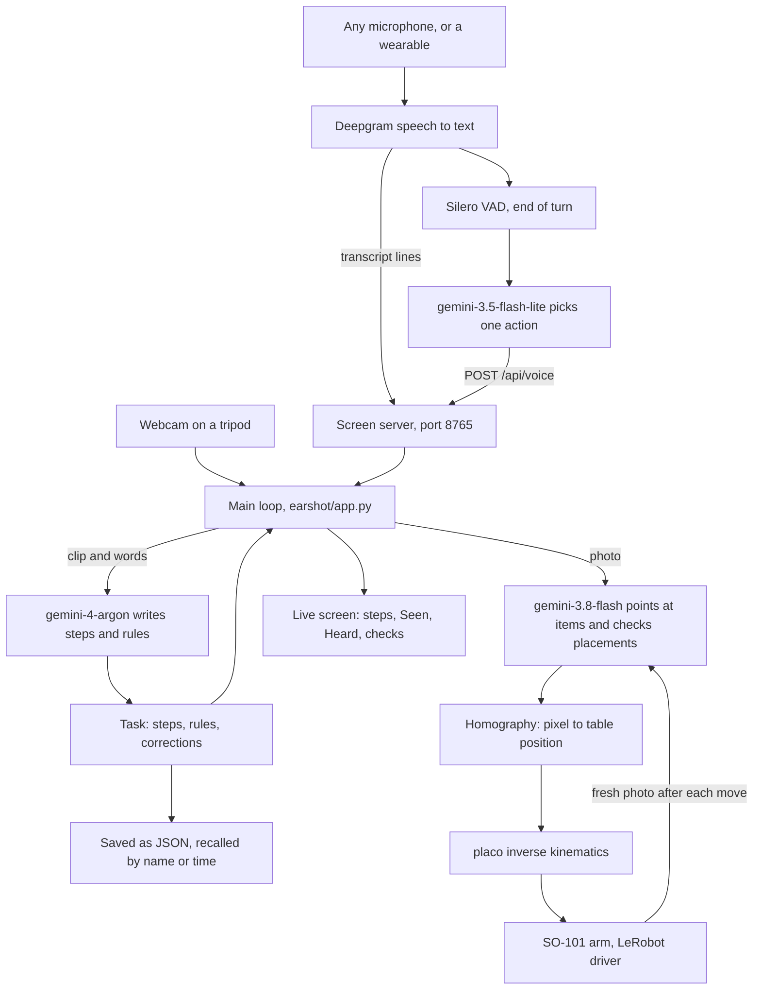

# Earshot

Earshot lets you teach a robot arm a table-top task by doing it once while you talk.

A webcam films the table. A microphone hears you: the laptop's own, a headset, a lapel mic or a wearable. A Gemini model turns the clip and your words into ordered steps and sorting rules. An SO-101 arm then does the task itself or hands you the next item, checks each result with the camera, and takes corrections by voice.

There is no trained policy, no teleoperation data and no fine-tuning. The model decides what to move and where. Our code turns that into motion.

## Why this matters

Teaching a robot a task today takes two things most workplaces do not have.

- **Robot-learning skill.** Someone has to set up cameras, record demonstrations, label them, train a policy and debug it.
- **Teleoperation.** The demonstrations are recorded by driving the arm by hand, many times over. It is slow and physically tiring. The week before building this I spent hours doing exactly that for one task on this same arm.

Meanwhile the knowledge of what the robot should do sits with someone else: the person who does the job. That person is the expert, and they are not a robotics engineer.

So the way to put robots within reach of everyone is to let the expert teach the way they already teach a new colleague: do the task once, and talk while doing it. Speech carries what a video cannot: which thing matters, why it goes there, what the rule is. Showing carries what speech leaves out. Earshot takes both, and a general model fills in the rest.

What that gives:

- **Anyone can teach.** No teleoperation rig and no training run. The person who knows the job is the one who teaches it.
- **Corrections are part of teaching.** "Yellow before blue" or "grip harder" changes the task on the spot, and the change is remembered.
- **Every lesson is also data.** Each taught task leaves a video, a transcript, an ordered list of steps, the corrections given, and a camera check of every move the robot made. That is labelled, supervised data, collected as a side effect of normal use. It could be used to train a policy for the same task later, much faster than recording teleoperation by hand. That last step is not built here.

## Why talking

A demonstration video shows what moved and where. It does not show why. Three things are only in the words:

- **Which thing matters.** "The pink ones" tells the robot that colour is the point, not size or position.
- **The rule behind the moves.** Three blocks into a bowl is three examples. "Pink goes in the bowl, the rest in the tray" is a rule that covers a block the robot has never seen.
- **What to watch for.** Order, care, exceptions: "this one last", "gently with that".

Talking also keeps working after the demonstration. The same voice channel carries corrections while the robot works, so teaching does not end when the recording does. And the same sentence means different things at different times: "the pink ones go in the bowl" is narration while the robot watches and a correction while it works. The voice model is told what the robot is doing right now and chooses by intent, not by key phrases.

## Ways to talk to it

Earshot needs 16 kHz speech from somewhere. It does not care where.

- **Any microphone the computer has.** This is the default: built-in, USB, Bluetooth headset, a wireless lapel mic. Pick one with `--mic`.
- **A wearable.** A mic on the wrist or collar stays close to the mouth while both hands work, and it is where the teaching happens. A Vexo Open wristband is supported as one example (`--band N`). Another device needs one small class with the same shape as `MicInput` in `earshot/voice/audio.py`.
- **Typed words.** `--say "your turn"` skips speech to text. Useful for testing.
- **The clip's own sound.** `scripts/vision_demo.py watch clip.mp4` lets the model listen to a recorded video directly.

Speech to text is Deepgram, through Pipecat, whichever microphone is used.

## How it works

1. **Watch.** Say "watch me". The app records the table at 5 frames a second and collects the words the microphone hears. Say you are done to stop.
2. **Understand.** The clip and the words go to Gemini. It returns a task: ordered steps, each with an item, a destination, what was Seen and what was Heard. It also returns sorting rules, including rules that were never said aloud. Where picture and words disagree the step is flagged, and the picture wins.
3. **Do or help.** "Your turn" makes the arm run every step and then apply the rules to any loose items left on the table. "Help me" makes the arm set the next item on a handover spot and wait until you take it.
4. **Check.** After each move a fresh photo is checked. If the item is not at its destination, or the gripper closed on nothing, the arm looks again and retries once.
5. **Correct.** By voice you can swap or move steps, change a destination, set a firmer or gentler grip, go slower or faster, pause, stop and redo a step, or skip one. Corrections are saved with the task. Saved tasks are recalled by name or time, for example "do what I taught you at 10".

## Architecture



The voice loop is a separate process in its own virtualenv. It never moves the arm. It posts one action per spoken turn to the main app, which holds the task and decides what "the yellow one" refers to.

## What each part does

| Path | Job |
|---|---|
| `earshot/app.py` | Main loop: teaching, the robot job thread, retries, voice actions |
| `earshot/schema.py` | The task format every part shares: steps, rules, corrections |
| `earshot/config.py` | Model names, camera, arm port, heights, ports, API key lookup |
| `earshot/camera.py` | Latest frame from the webcam, selected by name through ffmpeg |
| `earshot/vision/` | Gemini REST client, clip watcher, pointing, item listing, placement check, contact outline |
| `earshot/arm/` | LeRobot connection, kinematics, pixel to table mapping, camera drift correction, pick and place |
| `earshot/voice/` | Microphone audio into Pipecat, the pipeline, the action tools, the optional wristband source |
| `earshot/ui/` | FastAPI server, state API, websocket, the live screen |
| `earshot/state.py` | Thread-safe app state with change notifications |
| `earshot/store.py` | Saved tasks, found by name or by time |
| `scripts/` | Calibration, arm tests, vision demo, screen demo, voice entry point |

## Models and why

Each job has its own model, chosen from timed runs on the same clips and photo.

| Job | Model | Why |
|---|---|---|
| Watch the clip, write steps and rules, apply rules to loose items | `gemini-4-argon` | Right on both test clips. About 27 s |
| Point at items, list loose items, check a placement | `gemini-3.8-flash` | Fastest at about 2.5 s, and it points at an item's base |
| Pick one voice action | `gemini-3.5-flash-lite` | Short answer, forced to be a tool call, one request per spoken turn |

Speech to text is Deepgram `nova-3-general`.

## Hardware

* SO-101 follower arm, driven with LeRobot 0.6.2. Inverse kinematics by placo on the SO-101 URDF.
* One webcam on a tripod, looking down at the table at an angle. We used a Logitech C920.
* Any microphone. We used a Vexo Open wristband, over USB.
* Small tape marks on the table for calibration.

## Run it

It has been run on one setup: macOS, an SO-101 follower arm and a Logitech C920. The camera is opened through ffmpeg's avfoundation input, so another operating system needs a change in `earshot/camera.py`.

The main app needs ffmpeg and a Python environment with LeRobot 0.6.2 set up for the SO-101:

```
pip install -r requirements.txt
git clone https://github.com/TheRobotStudio/SO-ARM100.git   # the arm's URDF
```

Tell it about your bench, either in `earshot/config.py` or in the environment:

```
export EARSHOT_CAMERA="HD Pro Webcam C920"           # the camera's name as the system shows it
export EARSHOT_ARM_PORT=/dev/tty.usbmodemXXXX        # the arm's serial port
export EARSHOT_ARM_ID=follower                       # the name used for LeRobot's calibration
export EARSHOT_URDF=/path/to/SO-ARM100/Simulation/SO101/so101_new_calib.urdf
```

Keys:

```
cp .env.example .env
```

Fill in `GEMINI_API_KEY` and `DEEPGRAM_API_KEY`. `OPENAI_API_KEY` and `ELEVENLABS_API_KEY` are optional. `.env` is never committed.

Calibrate once. The motors stay off. You guide the gripper tip onto each tape mark by hand, then click the same marks in the camera picture. The script defaults to 6 marks. We used 8.

```
python scripts/arm_calibrate.py --marks 8
```

If the tripod gets bumped, click the marks again without touching the arm:

```
python scripts/arm_reclick.py
```

Main app. The screen is at http://127.0.0.1:8765.

```
python -m earshot.app              # camera, screen and arm
python -m earshot.app --no-arm     # camera and screen only, picks are announced
python -m earshot.app --speed 0.4  # slower arm, default 0.6
```

Voice loop, in its own Python 3.12 virtualenv so it cannot disturb the robot's packages:

```
python3.12 -m venv .venv-voice
.venv-voice/bin/pip install -r requirements-voice.txt

.venv-voice/bin/python scripts/voice_run.py                            # the default microphone
.venv-voice/bin/python scripts/voice_run.py --list-mics                # see the choices
.venv-voice/bin/python scripts/voice_run.py --mic "AirPods"            # one microphone, by name or number
.venv-voice/bin/python scripts/voice_run.py --say "watch me" --say "your turn"   # typed words, no microphone
```

`--no-tts` keeps the loop silent. A microphone hears everyone near it and the sound goes to Deepgram, so tell the people around you.

Optional, a Vexo Open wristband as the microphone:

```
git clone https://github.com/VexoAI-Org/vexo-open-kit.git vexo-open-kit
.venv-voice/bin/python scripts/voice_run.py --band N                                    # over Bluetooth
.venv-voice/bin/python scripts/voice_run.py --band N --usb --port /dev/cu.usbmodem1101  # over the USB cable
.venv-voice/bin/python scripts/voice_run.py --sim                                       # the kit's pretend band
```

`--port` is needed with `--usb` because the arm is a USB serial port too.

Other scripts:

```
python scripts/arm_pick_item.py "red block" --to "bowl" --check   # one named pick, checked by the camera
python scripts/arm_relax.py                                       # motors off after an unclean exit, hold the arm first
python scripts/ui_demo.py                                         # scripted screen demo, no hardware
python scripts/vision_demo.py watch clip.mp4 --silent --transcript words.txt
```

## What we learned

1. **LeRobot's zero is not the URDF's zero.** LeRobot measures degrees from the middle of each joint's calibrated range. The URDF measures from the calibration pose. On this arm they differ by up to 19 degrees. That tilted the table by 9 cm across the work area until `earshot/arm/robot.py` converted between the two.
2. **The motors refuse commands outside the calibrated range.** The wrist stops near 71 degrees, short of the URDF's 95. The IK now uses the tighter of the two limits and lets the gripper lean when straight down is out of range.
3. **The SO-101 gripper is one-sided.** One jaw is fixed and the other swings to one side, so the open gap is not centred on the tool point. The fixed jaw is aimed beside the item and the gap is opened to the item's measured width. The fixed jaw's tip also landed 0.45 cm along and 1.7 cm to the left of the aim, measured from a touch-down photo and corrected.
4. **A tilted camera sees an item's sides.** Only the points where an item meets the table lie on the table plane, so only those map exactly. The code traces that contact outline by colour and plans the grasp from it.
5. **A nudged camera can be corrected.** Before each job the calibration marks are found again in the picture. They vote on one common shift, marks that disagree are dropped, and at least two must agree.

## Limits

* Tasks made of pick and place only. It cannot learn a new physical skill such as writing or inserting a plug.
* Coloured items work best, because the contact outline is traced by colour. White, grey and black items fall back to a less exact grasp.
* Reach is small: items about 17 to 24 cm from the base, containers to about 30 cm.
* One retry per step. A step that fails twice is marked failed and the job moves on.
* Grasping was the least reliable part.

In the recorded run the arm picked and placed 3 of 3 blocks from one spoken demonstration. Grasping was the hardest part of the day: most attempts failed until the grasp was planned from where each block meets the table.

## Related work

The idea of a model reading a human demonstration and writing a robot plan is not new. Earshot is a small working system in that line, and what it adds is speech as a teaching signal and a live correction channel.

* [Code as Policies](https://arxiv.org/abs/2209.07753) (Liang et al., 2022): a language model writes the plan and classical code moves the robot. Earshot has the same split.
* [GPT-4V(ision) for Robotics](https://arxiv.org/abs/2311.12015) (Microsoft, 2023) and [VLM See, Robot Do](https://arxiv.org/abs/2410.08792) (2024): a vision-language model turns a human demonstration video into a task plan.
* [Chain-of-Modality](https://arxiv.org/abs/2504.13351) (2025): a model reads one human video together with other signals such as sound or force.
* Imitation learning from teleoperation, for example [ACT](https://tonyzhaozh.github.io/aloha) (Zhao et al., 2023), learns physical skills this system cannot, at the price of dozens of teleoperated demonstrations per task.

## Where this came from

Earshot was built in one day at VexoHacks (San Francisco, November 2026), where it took first place in the Google DeepMind track. The voice loop was built on the Vexo Open wristband there. It now takes any microphone.

## Contributing

Issues and pull requests are welcome. The most useful additions are a camera backend for Linux, support for another arm, a grasp that works for items without a clear colour, and logged trial sets on tasks beyond sorting blocks.

## Licence

MIT. See `LICENSE`.
