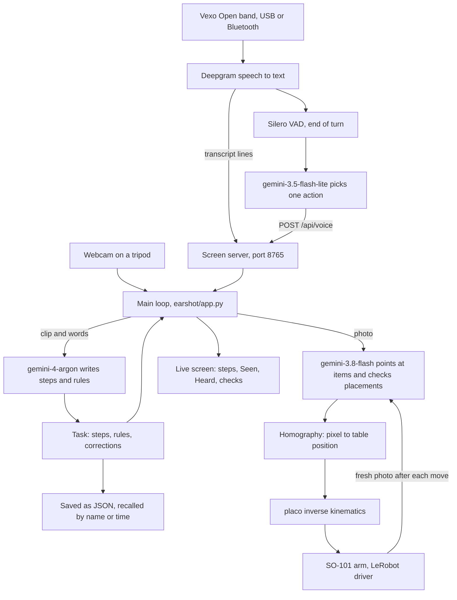

# Earshot

Earshot lets you teach a robot arm a table-top task by doing it once while you talk.

A webcam films the table. A wristband (the Vexo Open band) hears you. A Gemini model turns the clip and your words into ordered steps and sorting rules. An SO-101 arm then does the task itself or hands you the next item, checks each result with the camera, and takes corrections by voice.

There is no trained policy, no teleoperation data and no fine-tuning. The model decides what to move and where. Our code turns that into motion.

Built solo at VexoHacks, Y Combinator, San Francisco. Everything in this repository was written on 14 November 2026. The commit history shows the order.

## How it works

1. **Watch.** Say "watch me". The app records the table at 5 frames a second and collects the words the band hears. Say you are done to stop.
2. **Understand.** The clip and the words go to Gemini. It returns a task: ordered steps, each with an item, a destination, what was Seen and what was Heard. It also returns sorting rules, including rules that were never said aloud. Where picture and words disagree the step is flagged, and the picture wins.
3. **Do or help.** "Your turn" makes the arm run every step and then apply the rules to any loose items left on the table. "Help me" makes the arm set the next item on a handover spot and wait until you take it.
4. **Check.** After each move a fresh photo is checked. If the item is not at its destination, or the gripper closed on nothing, the arm looks again and retries once.
5. **Correct.** By voice you can swap or move steps, change a destination, set a firmer or gentler grip, go slower or faster, pause, stop and redo a step, or skip one. Corrections are saved with the task. Saved tasks are recalled by name or time, for example "do what I taught you at 10".

## Architecture



The voice loop is a separate process in its own virtualenv. It never moves the arm. It posts one action per spoken turn to the main app, which holds the task and decides what "the yellow one" refers to.

## What each part does

| Path | Job |
|---|---|
| `earshot/app.py` | Main loop: teaching, the robot job thread, retries, voice actions |
| `earshot/schema.py` | The task format every part shares: steps, rules, corrections |
| `earshot/config.py` | Model names, camera, arm port, heights, ports, API key lookup |
| `earshot/camera.py` | Latest frame from the webcam, selected by name through ffmpeg |
| `earshot/vision/` | Gemini REST client, clip watcher, pointing, item listing, placement check, contact outline |
| `earshot/arm/` | LeRobot connection, kinematics, pixel to table mapping, camera drift correction, pick and place |
| `earshot/voice/` | Band audio into Pipecat, the pipeline, the action tools |
| `earshot/ui/` | FastAPI server, state API, websocket, the live screen |
| `earshot/state.py` | Thread-safe app state with change notifications |
| `earshot/store.py` | Saved tasks, found by name or by time |
| `scripts/` | Calibration, arm tests, vision demo, screen demo, voice entry point |

## Models and why

Each job has its own model, chosen from timed runs on the same clips and photo.

| Job | Model | Why |
|---|---|---|
| Watch the clip, write steps and rules, apply rules to loose items | `gemini-4-argon` | Right on both test clips. About 27 s |
| Point at items, list loose items, check a placement | `gemini-3.8-flash` | Fastest at about 2.5 s, and it points at an item's base |
| Pick one voice action | `gemini-3.5-flash-lite` | Short answer, forced to be a tool call, one request per spoken turn |

Speech to text is Deepgram `nova-3-general`.

## Hardware

* SO-101 follower arm, driven with LeRobot 0.6.2. Inverse kinematics by placo on the SO-101 URDF.
* One Logitech C920 webcam on a tripod, looking down at the table at an angle.
* One Vexo Open wristband, over USB or Bluetooth.
* Small tape marks on the table for calibration.

## Run it

The main app runs in a Python environment that already has LeRobot 0.6.2, OpenCV, FastAPI and requests. There is no requirements file for it. The camera name, arm port and URDF path in `earshot/config.py` are specific to this machine.

Keys:

```
cp .env.example .env
```

Fill in `GEMINI_API_KEY` and `DEEPGRAM_API_KEY`. `OPENAI_API_KEY` and `ELEVENLABS_API_KEY` are optional. `.env` is never committed.

Calibrate once. The motors stay off. You guide the gripper tip onto each tape mark by hand, then click the same marks in the camera picture. The script defaults to 6 marks. We used 8.

```
python scripts/arm_calibrate.py --marks 8
```

If the tripod gets bumped, click the marks again without touching the arm:

```
python scripts/arm_reclick.py
```

Main app. The screen is at http://127.0.0.1:8765.

```
python -m earshot.app              # camera, screen and arm
python -m earshot.app --no-arm     # camera and screen only, picks are announced
python -m earshot.app --speed 0.4  # slower arm, default 0.6
```

Voice loop, in its own Python 3.12 virtualenv, with the band kit cloned beside the code:

```
python3.12 -m venv .venv-voice
.venv-voice/bin/pip install -r requirements-voice.txt
git clone https://github.com/VexoAI-Org/vexo-open-kit.git vexo-open-kit

.venv-voice/bin/python scripts/voice_run.py --band N                                    # your band over Bluetooth
.venv-voice/bin/python scripts/voice_run.py --band N --usb --port /dev/cu.usbmodem1101  # over the USB cable
.venv-voice/bin/python scripts/voice_run.py --sim                                       # the kit's pretend band
.venv-voice/bin/python scripts/voice_run.py --say "watch me" --say "your turn"          # typed words, no band
```

`--port` is needed with `--usb` because the arm is a USB serial port too. `--no-tts` keeps the loop silent.

Other scripts:

```
python scripts/arm_pick_item.py "red block" --to "bowl" --check   # one named pick, checked by the camera
python scripts/arm_relax.py                                       # motors off after an unclean exit, hold the arm first
python scripts/ui_demo.py                                         # scripted screen demo, no hardware
python scripts/vision_demo.py watch clip.mp4 --silent --transcript words.txt
```

## What we learned

1. **LeRobot's zero is not the URDF's zero.** LeRobot measures degrees from the middle of each joint's calibrated range. The URDF measures from the calibration pose. On this arm they differ by up to 19 degrees. That tilted the table by 9 cm across the work area until `earshot/arm/robot.py` converted between the two.
2. **The motors refuse commands outside the calibrated range.** The wrist stops near 71 degrees, short of the URDF's 95. The IK now uses the tighter of the two limits and lets the gripper lean when straight down is out of range.
3. **The SO-101 gripper is one-sided.** One jaw is fixed and the other swings to one side, so the open gap is not centred on the tool point. The fixed jaw is aimed beside the item and the gap is opened to the item's measured width. The fixed jaw's tip also landed 0.45 cm along and 1.7 cm to the left of the aim, measured from a touch-down photo and corrected.
4. **A tilted camera sees an item's sides.** Only the points where an item meets the table lie on the table plane, so only those map exactly. The code traces that contact outline by colour and plans the grasp from it.
5. **A nudged camera can be corrected.** Before each job the calibration marks are found again in the picture. They vote on one common shift, marks that disagree are dropped, and at least two must agree.

## Limits

* Tasks made of pick and place only. It cannot learn a new physical skill such as writing or inserting a plug.
* Coloured items work best, because the contact outline is traced by colour. White, grey and black items fall back to a less exact grasp.
* Reach is small: items about 17 to 24 cm from the base, containers to about 30 cm.
* One retry per step. A step that fails twice is marked failed and the job moves on.
* Grasping was the least reliable part.

PICK_RESULTS: to be filled in

## Sponsor tracks

* Deepgram, "Best Voice Use Case on Pipecat": the voice loop is a Pipecat pipeline (pipecat-ai 1.16) with Deepgram speech to text on the band's audio.
* Google DeepMind, "Best Use of Gemini 4": `gemini-4-argon` watches the demonstration and writes the steps and rules.

Repository: https://github.com/MNS1007/earshot
